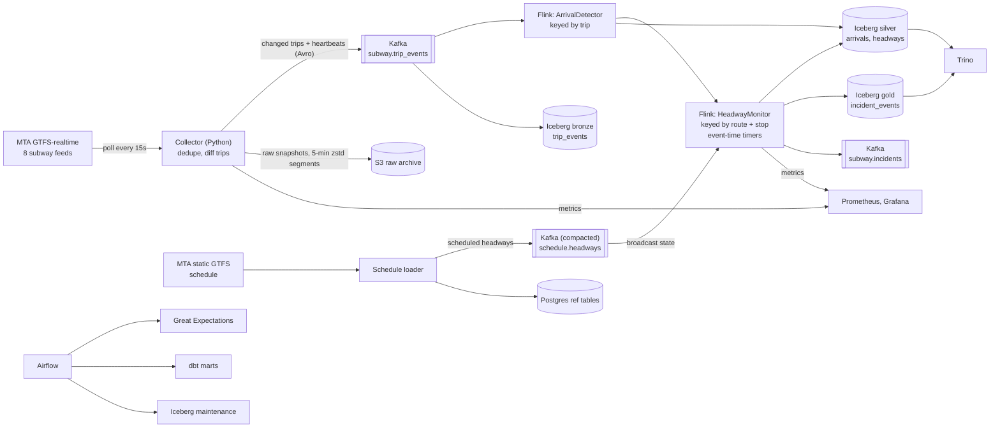

# SubwayPulse

**Real-time NYC subway reliability from the MTA's public feeds.** SubwayPulse works out when every train actually reached every station, then flags bunched trains as they happen and gaps in service *while riders are still waiting*, typically about a minute after the gap becomes knowable.


**Stack:** GTFS-realtime (protobuf) · Kafka + Schema Registry (Avro) · Apache Flink (Java, event time, keyed and broadcast state) · Apache Iceberg · Trino · dbt · Airflow · Great Expectations · Prometheus/Grafana · Terraform (AWS) · Docker

---

## The problem

The subway's real-time feeds say where each train is *predicted* to be. They never say "the train arrived at Bedford Av at 8:14:32". Yet that is what reliability is made of: how long riders actually waited between trains.

Two failures matter most to riders:

- **Bunching.** Two trains arrive almost together, then nothing for a long time. The average looks fine; the wait doesn't.
- **Gaps.** No train for far longer than scheduled. Most reports only notice a gap when the late train finally shows up, by which point riders have waited ten minutes or more.

The feeds also make this harder than it looks. Each of the 8 feed groups refreshes every few seconds with mostly unchanged data, snapshots are sometimes stale, trains blink out for one refresh, and the endpoint sometimes returns errors.

## What it produces

| Output | What it is | When |
|---|---|---|
| `silver.arrivals` | Every inferred arrival: train, station, time | About 25s after the train arrives (median) |
| `silver.headways` | Time since the previous train at that station, against the schedule for that stop and hour | When the arrival is released (in order) |
| `BUNCHING` incident | Headway ≤ max(90s, 30% of scheduled) | About 2 minutes after the second train arrives |
| `GAP_OPENED` incident | No train for scheduled + max(5 min, scheduled) | **While the gap is happening** |
| `GAP_CLOSED` incident | The next train arrived; carries the real headway | When it arrives |
| `fct_line_reliability_hourly` | Per route and hour: excess wait time, bunching and gap counts | Nightly dbt build |

Incidents also go to the Kafka topic `subway.incidents` for alerting.

## Architecture



All tables are Apache Iceberg on S3 (SeaweedFS locally), with a JDBC catalog in Postgres. Flink commits on every checkpoint (30s), so the tables stay close to the stream.

## How it works

1. **Collect only what changed.** The collector polls each feed, drops fetches whose content didn't change, and fingerprints every trip. Only trips whose stops, predictions, or status changed are sent to Kafka, plus a `VANISHED` record when a trip leaves the feed. It counts what it *would* have sent without the diff, so the saving is measured, not estimated.
2. **Keep event time moving.** After every fetch the collector sends a small heartbeat to every Kafka partition. Otherwise a quiet partition would hold back Flink's watermark, and with it every timer.
3. **Infer arrivals.** `ArrivalDetector` keeps each train's list of stops still ahead. When a stop drops off the front of that list, or the train reports it is stopped at it, the train has arrived. It rejects skipped stops and reroutes, handles trains blinking out of the feed, and emits each (train, station) once even after a collector restart.
4. **Judge headways in order.** Arrivals at one station come from different trains on different partitions, so `HeadwayMonitor` buffers them until the watermark passes, then releases them in arrival order and compares each headway with the schedule for that stop, date, and hour.
5. **Catch gaps live.** After each train, an event-time timer is set for when the next one would be overdue. If it fires first, `GAP_OPENED` goes out immediately. No timer fires when no service is scheduled, so the end of the night isn't a false alarm.
6. **Schedule as broadcast state.** The loader turns MTA's static GTFS into median scheduled headways per stop and hour and publishes them to a compacted topic. Flink holds them as broadcast state, so a new schedule (including planned service changes) is picked up without a restart.
7. **Batch layer.** Airflow runs Great Expectations on the silver tables, then builds dbt marts, including excess wait time per line and hour. An hourly DAG compacts Iceberg files, expires snapshots, and removes orphans.

The reasoning behind each choice (Flink vs. Spark, exactly-once vs. at-least-once, the cost of 30-second commits, and the bugs found along the way) is in [docs/design-decisions.md](docs/design-decisions.md).

## Results

### Accuracy, measured against ground truth

The live feeds can't say when a train *really* arrived, so they can't score the pipeline. The repo includes a simulator that moves trains along the MTA's real static schedule with drift, held trains, and minimum spacing (so a held train creates a gap ahead of it and bunching behind it). It serves feeds in MTA's format with realistic noise (stale snapshots, HTTP 503s, trains blinking out, imprecise platform times) and records the true arrival of every train at every stop. The evaluator scores the pipeline's output against that.

150 simulated minutes of a weekday morning rush (A, C, E, G and L lines, 587 trips), run in real time. The first 10 minutes are warm-up and not scored.

| Metric | Result |
|---|---|
| Real arrivals found | **99.8%** (6,324 of 6,336), none made up |
| Arrival time error | 9s median, 29s p95 |
| Arrival available after the train arrived | 23s median, 46s p95 |
| Gaps caught **while still open** | **94.7%** (142 of 150) |
| Gap alerts that were real | **90.4%** |
| Gap alert, after the gap became knowable | **59s median**, 85s p95 |
| Bunching caught | 80.9% (411 of 508), 85.6% of alerts real |
| Bunching alert, after the second train arrived | 120s median, 149s p95 |

Most misses sit right at a threshold. Bunched trains in the simulator run 75 to 90 seconds apart, against a 90-second threshold, and platform times carry ±15 seconds of noise, so the noise decides those cases. Bunching alerts take longer than gap alerts because each arrival waits for the watermark plus a 60-second release delay, so out-of-order arrivals are sorted first.

**The first run was much worse, and the evaluator showed why.** Only 58.5% of gap alerts were real. Matching each false alert against the ground truth found three bugs: trains held at a platform counted as arrived only when they left, the gap timer raced arrivals waiting for release, and two parts of the job used different hours' schedules at the top of the hour. Over the same window, real gap alerts went from 58.5% to 79.5% to 87.9%. The full story is in [design decisions](docs/design-decisions.md), and the raw evaluator output is in [docs/simulator-results.md](docs/simulator-results.md).

**Change-only publishing, measured on the same run:** 48% of fetches had no new content and were dropped before parsing. Kafka received 5.4 MB of trip events instead of 14.3 MB (62% less). The raw archive wrote 81 compressed objects (1.0 MB) instead of one object per fetch (17.1 MB). These are simulator feeds, which refresh every 30 seconds, so the live numbers will differ.

### On the live MTA feeds

The same stack runs against all 8 of the MTA's subway feeds with no changes. In the first 8 minutes of a weekday evening rush, it inferred 1,904 arrivals across 30 routes, including shuttles and express variants.

Numbers from a longer live run are produced by `docker compose run --rm live-report` (see [docs/running-live.md](docs/running-live.md)). Live feeds have no ground truth, so accuracy is measured only on the simulator.

### Cost

The whole stack runs on one machine. During the simulator run the streaming path (collector, Kafka, Flink) averaged under a third of one CPU core. On AWS, the Terraform setup is a single `t4g.xlarge` at $0.1344/hour, about $98/month on demand, plus S3. Details and sources: [docs/cost.md](docs/cost.md).

## Run it locally

**Needs:** Docker Desktop with about **8 GB of memory** assigned (Windows: WSL 2 backend). The MTA's subway feeds are public and need no API key.

**On the live feeds:**

```bash
git clone https://github.com/Akrammujtaba/subwaypulse.git
cd subwaypulse
docker compose up -d --build        # first build takes ~10 minutes
```

**On the simulator, with scoring:**

```bash
docker compose -f docker-compose.yml -f docker-compose.sim.yml up -d --build
# let it run 30+ minutes, then:
docker compose -f docker-compose.yml -f docker-compose.sim.yml run --rm evaluator
```

| What | Where |
|---|---|
| Grafana dashboard | http://localhost:3000 |
| Flink UI | http://localhost:8082 |
| Airflow | http://localhost:8081 (admin / admin) |
| Trino | http://localhost:8080 |

**Query it:**

```bash
docker compose exec trino trino --catalog lake
```
```sql
SELECT route_id, status, count(*) AS headways, round(avg(headway_s)) AS avg_s
FROM silver.headways GROUP BY 1, 2 ORDER BY 1, 2;
```

**Watch incidents as they fire:**

```bash
docker compose exec kafka /opt/kafka/bin/kafka-console-consumer.sh \
  --bootstrap-server kafka:9092 --topic subway.incidents
```

**Stop:** `docker compose down` (keeps data) or `docker compose down -v` (wipes it). More on live runs: [docs/running-live.md](docs/running-live.md).

## Testing

```bash
pip install -r requirements-dev.txt && pytest       # Python: parsing, schedule, simulator, rule parity
cd flink-jobs && mvn test                           # Java: inference, rules, both Flink operators
cd dbt && dbt seed --target ci --profiles-dir . && dbt build --target ci --profiles-dir .   # dbt on DuckDB
```

- **Arrival inference:** skipped stops, reroutes, trains blinking out, resent trips, out-of-order updates, trains held at a platform
- **Flink operators** (test harnesses with watermarks): out-of-order arrivals sorted before headways, bunching, a gap opening while it happens and closing later, no gap when the next train already arrived but isn't released yet, no alarm when no service is scheduled
- **Rule parity:** the Java rules and the Python rules the evaluator uses agree on a table of edge cases, so the pipeline isn't scored against different rules than it runs
- **CI** (GitHub Actions): lint, Python tests, Flink build and tests, dbt build, Airflow DAG import, Docker builds, Terraform validate

## Repository layout

```
subwaypulse/          collector, GTFS-rt parsing, change tracking, schedule loader, evaluator
  sim/                simulator: train model, feed generator, HTTP server with ground truth
flink-jobs/           Flink job (Java 17): arrival inference, headway monitor, Iceberg sinks
dbt/                  staging models, reliability marts, tests, DuckDB CI fixtures
airflow/dags/         daily quality + dbt, hourly Iceberg maintenance
infra/                Postgres, SeaweedFS, Trino, Prometheus, Grafana, Flink and Airflow images, Terraform
docs/                 design decisions, cost, running on the live feeds
```

## Data and terms

Subway data is obtained from the Metropolitan Transportation Authority (MTA) through its public real-time and static GTFS feeds, under the [MTA's data feed terms](https://www.mta.info/developers/terms-and-conditions). This project is not affiliated with or endorsed by the MTA, and makes no claim that the data is accurate or timely. The repository contains code only. No MTA data is committed; tests use generated data.

## What's next

Planned improvements are in [ROADMAP.md](ROADMAP.md).

## License

MIT
